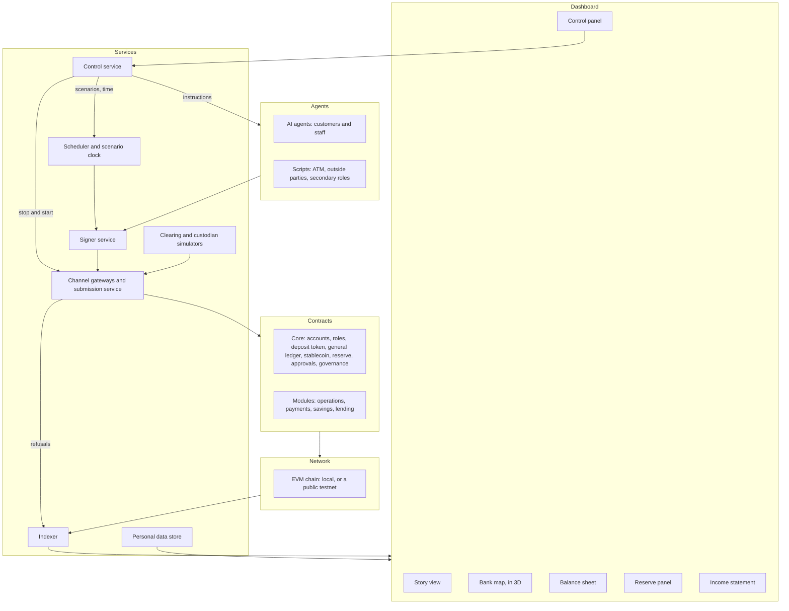
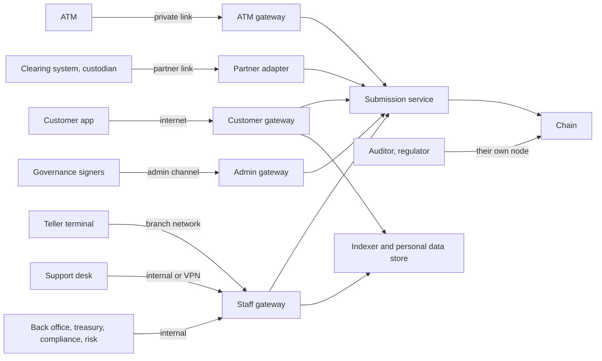
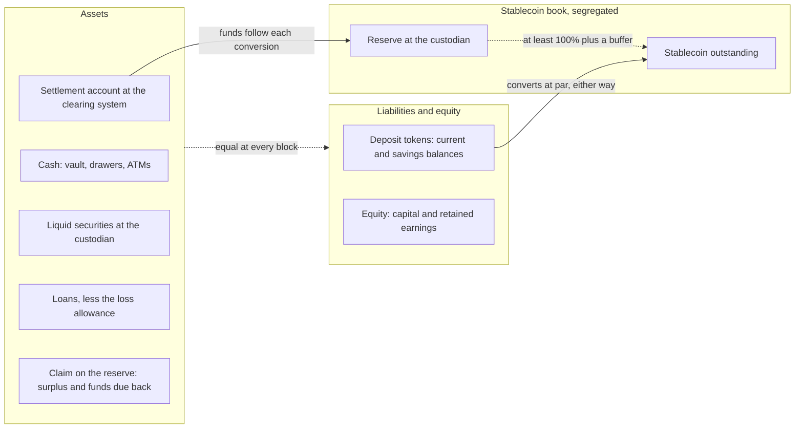
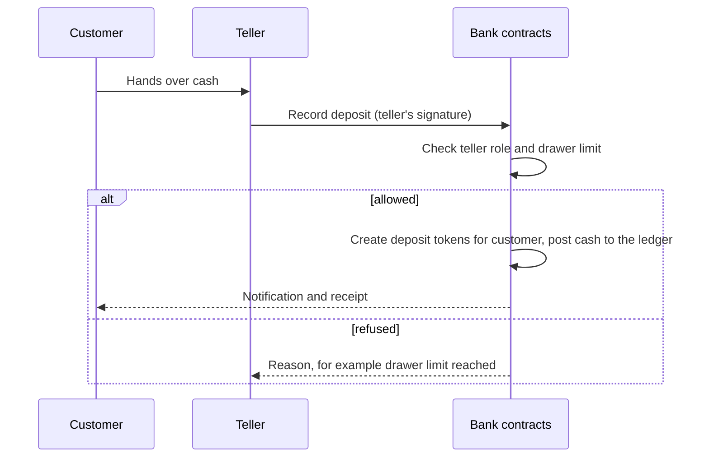
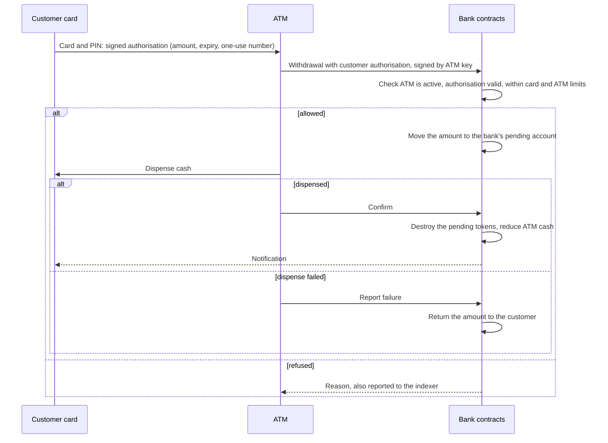
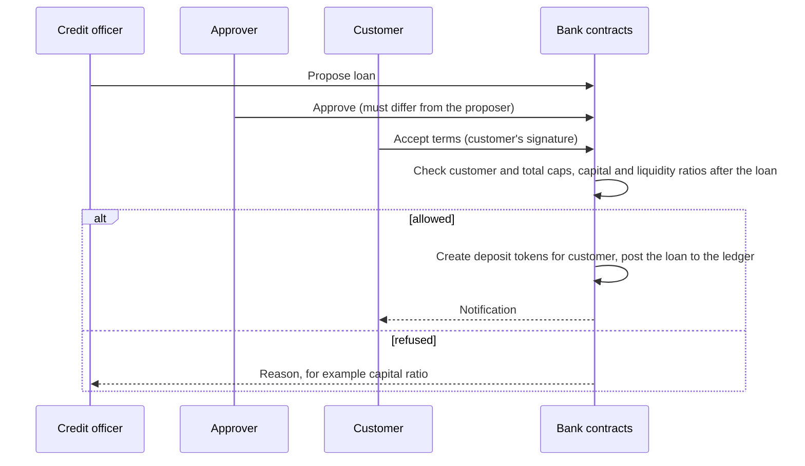

# Architecture

## Positioning

The bank's everyday money is a tokenised deposit. Each current-account balance is a token that is a claim on the bank, as a bank balance is today. Lending creates these tokens and repayment destroys them, within capital and liquidity limits the chain enforces. Savings accounts and loans are modules on top. Beside it the bank issues a fully reserved HKD-referenced stablecoin as a separate product.

Three things keep it a recognisable bank:

- **Assisted service.** Customers can act for themselves from their own devices, but tellers and ATMs still take cash, act on customers' instructions, and handle anything large, unusual or needing identity checks.
- **Open to the payment system, closed to holders.** Customers pay and are paid by account holders at other banks through a simulated clearing system. Only holding the tokens is closed: the chain is public, but each token's allow-list admits only onboarded customers. Taking the stablecoin onto a shared chain is a planned [expansion](plan.md#cross-chain), not part of this design.
- **Two forms of money, each for what it suits.** The deposit token is for everyday banking: a claim on the bank that funds lending and earns interest in a savings account, the form Hong Kong banks are piloting in Project Ensemble. Its backing is the bank's balance sheet, which is kept on chain as a general ledger. The stablecoin is for holders who want a claim backed by a segregated reserve and not by the bank's balance sheet, and it is the token that could later leave the perimeter.

## Layers



| Layer | Responsibility |
|---|---|
| **Network** | Any EVM chain. A single-process local chain for development, tests and the live demo, and a public testnet for a standing deployment anyone can inspect. See [network](#network). |
| **Contracts** | The rules. Nothing above this layer is trusted to enforce anything. |
| **Services** | Hold keys, carry requests to the chain, turn chain events into a timeline, drive time, simulate outside parties, and keep personal data off the chain. |
| **Agents** | Decide what to attempt. They never hold keys and cannot bypass the contracts. |
| **Dashboard** | Explains what happened and why, for a non-technical viewer, and lets the operator direct agents and trigger scenarios. |

## Network

The contracts run on any EVM chain with the Cancun rules or later. Nothing in them depends on who runs the chain.

| Profile | Chain | Used for |
|---|---|---|
| **Local** | A single-process chain on the presenter's machine | Development, tests and the live demo. Offline, free, and the same every run. |
| **Public** | Base Sepolia, the public testnet of an Ethereum layer 2 | A standing deployment that anyone can inspect from a link, through the chain's block explorer |

Mainnet is not used. Real gas would buy nothing a testnet does not show.

- **Why not the bank's own chain.** A production bank might run a permissioned chain with validators at its own sites, mainly for ledger privacy. Nobody will deploy this demo on one, and a reviewer can check a public deployment from a link without running anything. See [standards](standards.md#considered-and-not-used).
- **Who checks the bank.** Every node that follows the public chain re-executes every block, and the layer 2 posts its data to Ethereum. The bank cannot rewrite its history there, and anyone, the auditor and the regulator included, can check it without the bank's help. On the local chain the bank runs the only node, so that profile shows the rules, not the history.
- **Closed to holders, open to view.** Only onboarded customers can hold either token. The allow-list on each token enforces it, not the chain.
- **Ledger privacy.** Every balance and transfer is public by address, with no names. The link from address to person lives in the personal data store. Anyone who ties one address to a person can follow that customer's money, which a real bank could not accept; it would need its own chain or a privacy layer. Every customer here is simulated.
- **Gas.** The submission service pays it from a key the bank funds. It is free on the local chain and comes from a faucet on the testnet.
- **No offline writes.** Nothing confirms without the chain, and a branch or ATM cut off from it stops. Real ATM networks allow limited offline approvals; this design does not.

What differs from production: keys are held by the signer service and not a hardware module, and network zones are Docker networks, not real firewalls.

### Failure scenarios

| Scenario | Behaviour |
|---|---|
| A channel gateway stopped | That channel stops; other channels continue |
| Branch link cut | That branch stops; its customers use the app, an ATM or another branch |
| Chain unreachable | Every channel stops. Signed requests wait in the submission service and go through when the chain returns, unless their validity window has passed. |

Consensus, validator and node failures belong to whoever runs the chain and are not simulated.

## Channels

No bank client writes to the chain directly. Every party reaches it through a gateway for its channel, which forwards to the submission service.



| Channel | Who | Network | Where the signature is made | Notes |
|---|---|---|---|---|
| **Customer app** | Customers | Internet | On the customer's device, by passkey | The app sends a signed authorisation; the key never leaves the device |
| **ATM** | ATMs | Private link to the bank | In the machine's hardware module, plus the customer's card and PIN | See [customer authorisation](#customer-authorisation) |
| **Branch** | Tellers, supervisors, branch manager, account opening, vault custodian | Branch network | On the staff member's device or hardware token | The customer authorises by card, by device, or on paper |
| **Support** | Support desk | Internal network or VPN | Staff device | Protective and servicing functions only; no paying out to others. See [customer authorisation](#customer-authorisation). Customer details come from the personal data store, gated by role. |
| **Head office** | Back office, compliance, treasury, finance, risk, IT security | Internal network | Staff device | |
| **Partner** | Clearing system, custodian | Dedicated partner link | Partner signs its own messages | An adapter relays ISO 20022 payment messages and signed statements to the chain. The contracts check the partner's signature over the fields they act on and the hash of the full message against its registered key, so the adapter holds no role that can create money. Partners hold no chain accounts. |
| **Admin** | Governance signers | Separate admin channel | Hardware keys | Used only for multi-signature approvals |
| **Assurance** | Auditor, regulator | Their own node on the public chain | None | Read-only on the ledger |

**What each part does**

- **Gateway.** One per channel. Establishes a session, limits request rates, logs, and exposes only the functions that channel needs. It never holds signing keys.
- **Submission service.** Simulates each signed request before sending it, sends it to the chain, and reports the outcome, including refusals, to the indexer. It pays the gas; a request's authority comes from the signatures inside it, never from who sent it.
- **Reads.** Applications read through the indexer and personal data store, which apply the caller's role. The chain itself is public by address; what the services gate is the link to names.

**Trust**

- A gateway is not trusted to authorise anything. The chain checks every signature and role itself, so a compromised gateway cannot move money. It can only delay or drop requests. That holds for the partner adapter too: a payment in or a statement is accepted only with the partner's own signature.
- A partner is trusted for what it signs. A stolen partner key could create money against a credit that never arrived, so partner keys are significant keys, registered and replaced only through governance, and finance reconciles against the partner's own records.
- A channel failing affects that channel only. If the ATM gateway is down, branches and the app continue.
- Zones (internet-facing, branch and ATM, internal, partner, submission) are separate networks, so a client in one zone cannot reach the submission service or another zone's gateway.

**In the simulation**

- The signer service stands in for every device's secure hardware: phones, cards, staff tokens and ATM modules. For a phone it returns a WebAuthn assertion in the same form a browser does, so when the operator takes over a role and a real passkey in the browser signs instead, nothing changes on chain.
- The gateways run as one service with a route set per channel, on separate Docker networks per zone.

## Design rules

1. **The chain decides, agents propose.** An agent's prompt is never the control. If an agent attempts something outside its role, the contract refuses it.
2. **Authority comes from role and device, not from a key.** People and devices come and go; accounts and balances do not move.
3. **No personal data on chain.** The chain holds addresses, identifiers and hashes. Names, ID details, payment details and scanned instructions live in an ordinary database, so they can be corrected or deleted.
4. **Names are gated like writes.** Staff and agents read through services that apply the same roles. The chain shows addresses to anyone; who an address belongs to is released only by role.
5. **Each money keeps its own rule.** Deposit tokens are created or destroyed only with a balanced ledger entry, and by lending only within the capital and liquidity ratios. The stablecoin is always fully backed.
6. **Products are modules.** Each product is built on the tokens through standard interfaces and can be added or removed without changing the core.
7. **Use audited standard components where they fit.** Write only the bank-specific logic. See [standards](standards.md).

## Account model

Every party is a smart account with a stable address.

| Party | Account type | Signers |
|---|---|---|
| Retail customer | Multi-signer account | Each of the customer's devices and their bank card, any one sufficient |
| Corporate customer | Multi-signer account with a threshold | Authorised signatories, for example any two of three |
| Staff member | Multi-signer account | The staff member's devices; holds roles in the access manager |
| Machine (ATM) | Single-key account | A key held in the signer service, standing in for a hardware module |
| Bank-owned accounts | Role account | Whoever currently holds the controlling role |

Bank-owned accounts are the few that hold tokens in passing: pending withdrawals and payments, suspense, and stablecoin awaiting burn. The bank's own funds are not a token balance. A deposit token is a claim on the bank, so the bank holding one would owe itself; its funds are equity in the [general ledger](#money-model).

Adding or removing a device changes the account's signer list. Hiring or offboarding a staff member grants or revokes roles. In both cases the account address, its balance and its history are untouched.

Staff always transact from their own account, never through a shared one. This keeps every action attributable to a person and lets the contracts check that the approver of an operation is not its maker.

### Device trust tiers

| Tier | Example | Trust basis |
|---|---|---|
| Customer device | Phone or browser passkey | Possession plus biometric or device PIN |
| Bank card | Chip card with PIN | Possession plus PIN, used at a bank-controlled terminal |
| Staff terminal | Teller workstation | Bank-managed device plus staff role |
| Machine | ATM | Bank-managed hardware key |

A multi-signer account treats its signers as equal, so limits do not depend on which device signed. They are set by channel. The contracts see who submitted the request (the account itself from the app, an ATM, or a teller) and apply a rate limit keyed by account and channel. A card signs only at a bank-controlled terminal, so the ATM and branch channels cover it.

A customer account accepts only two kinds of device key: a passkey, checked as a WebAuthn assertion that shows the customer was present and verified, and a card's P-256 key. Neither the customer nor a recovery officer can register any other kind, so no one can slip in a key that accepts every signature.

### Customer authorisation

How a customer consents depends on the channel. Self-service is limited by amount; the branch is not, and adds people as the amount grows.

| Mode | Where | Evidence the chain sees | Controls |
|---|---|---|---|
| **Own device** | App, or at a counter | Customer's signature | App limit when sent from the app |
| **Card and PIN** | ATM, counter | Card's signature, submitted by the ATM or teller | ATM limit when used at an ATM |
| **Paper instruction** | Counter | None from the customer. The teller attests to an in-person identity check, attaching the hash of the scanned slip. | No amount cap; approvals escalate with amount; customer notified at once |

The branch is the highest-trust channel. Identity is checked in person and more than one member of staff is involved, so a customer at a counter can do anything, including what their own devices cannot.

- **No cap, escalating approval.** A teller alone handles small amounts. Above a threshold a supervisor approves, above a higher one the branch manager as well, and compliance for the largest. A larger amount never means a refusal, only more people. The steps are in the [branch approval ladder](roles.md#branch-approval-ladder).
- **More than self-service.** The branch can recover an account with no devices left, raise the customer's own limits, register a payee on the spot, unfreeze and close.
- **On by default.** Assisted service needs no opt-in. A customer may restrict it for their own account.
- **Collectively, not individually.** No single member of staff is all-powerful; the branch as a whole is.
- **Still inside the bank's rules.** The lending guard, the mint guard, a pause, compliance holds and screening apply to the branch as to everyone.

Paper is how most branch customers instruct a bank today, so it is a normal path. It is also the main path where the bank moves a customer's money without the customer's own cryptographic consent:

- **Who can act.** Only the assisted-operations module, called by a teller of the customer's branch, with the approvals the amount requires. Every debit on paper needs at least one approver besides the teller.
- **What it leaves behind.** The teller, the approvers and the slip hash are recorded with the operation. Internal audit samples operations against the scanned slips.
- **What it does not stop.** Staff acting together can move a customer's money. That is true of any bank; the defences are the number of people required as amounts grow, the notification, the audit trail and the customer's ability to dispute.
- **Disputes.** A disputed operation can be frozen by support and reversed by back office with compliance approval.

**Support** is all-powerful to protect and to help, not to pay out. Identity over the phone is weaker than at a counter, and call centres are the main target for impersonation.

- **Can, at any amount and at once:** freeze, revoke devices and cards, stop a pending payment, open a dispute, lower limits, move money between the customer's own accounts and products.
- **Cannot:** send money to a new destination, raise limits, or register a payee. Those need the customer's own device or a branch visit.

Credits to an account, such as a cash deposit or an incoming payment, need no customer authorisation.

### Bank-initiated movement

A bank can move a customer's money without the customer signing, and a simulation of one must be able to as well. Both tokens carry a forced transfer that no person can call directly. Only these modules can, each with its own approvals, and each use records who acted and why:

| Path | Called by | Approvals | Evidence recorded |
|---|---|---|---|
| Paper instruction | Teller of the customer's branch | Branch approval ladder | Slip hash |
| Move between a customer's own accounts and products | Support | None; source and destination must be the same customer | Call reference |
| Reverse a disputed operation | Back office | Compliance | Dispute reference |

A forced transfer cuts through a freeze, by design of the standard. Dispute reversal relies on that: it takes money that is frozen. The other two paths must not, so those modules refuse anything beyond the customer's unfrozen balance. In every case the recipient must be an onboarded account.

A freeze and an operational hold are different things. A freeze is placed by compliance, support or a dispute and stays in the customer's account; each is a named hold, and the frozen amount is their sum. An ATM withdrawal or a payment awaiting release instead moves the amount to a bank-owned pending account, under the customer's own authorisation.

Freezes and forced transfers reach savings shares as well as the two tokens, so money cannot be put beyond a hold by moving it into the savings account. A hold freezes the current account first and savings for the rest, counting the shares that withdrawing the remainder would take; interest only adds to their value. Money is taken from savings by forcing the shares to a bank-owned account and withdrawing them there.

Fees, loan instalments and standing orders are not forced. They are collected under a mandate the customer signed.

A reversal takes back only what is still in the recipient's account, which is why a dispute freezes first. If the money has gone and the bank was at fault, the bank makes the customer whole from its own funds, as an expense.

### Account recovery

A customer who has lost every device and their card still owns the account. The account lets one bank module change its signer list: the recovery module, called by an account opening officer with a supervisor's approval, after an in-person identity check. It can add and remove signers and nothing else; it cannot move money. The customer is notified through every contact the bank holds.

### Customer account controls

- Customers can set their own lower limits per type of transaction.
- The number of devices and cards bound to an account is capped.
- Every account operation sends the customer a notification through the bank's own channel.
- Customers can see their full transaction history.

## Money model

The bank's books are a double-entry general ledger kept on chain. Every operation that creates, destroys or reclassifies money posts a balanced entry in the same transaction as the token movement, so the tokens and the books cannot disagree.

The chain keeps a running balance for each account in the [chart of accounts](#chart-of-accounts) and emits each entry as an event; it does not store the entries themselves. The contracts only ever read balances, and the timeline and the ledger entry under each story line are built from the events. The ledger is the only contract that may create or destroy deposit tokens, and it reads the Deposits balance from the token's supply, so there is no second figure to drift.



### Chart of accounts

| Account | Side | What it holds |
|---|---|---|
| Settlement account | Asset | The bank's balance at the clearing system, attested |
| Cash | Asset | Vault, drawers and ATMs, attested by count |
| Liquid securities | Asset | The bank's own bills at the custodian, attested |
| Loans | Asset | Principal outstanding |
| Loan loss allowance | Asset, negative | Expected losses on loans not yet written off |
| Reserve surplus | Asset | The bank's own money in the stablecoin reserve: the buffer and retained yield. It ranks behind the holders. |
| Due from reserve | Asset | Reserve released by redemptions and not yet back in the settlement account |
| Deposits | Liability | All deposit tokens outstanding |
| Equity | Equity | Capital and retained earnings |

The stablecoin outstanding and the reserve that backs it stay in their own book. The general ledger carries only what is the bank's own: the surplus and funds due back.

### The deposit token

One token is one Hong Kong dollar the bank owes its holder: a current-account balance.

| Event | Deposit tokens | Other side of the entry |
|---|---|---|
| Cash paid in | Created | Cash rises |
| Payment received from another bank | Created | Settlement account rises |
| Loan drawn down | Created | Loans rise |
| Interest paid to savers, a refund | Created | Retained earnings fall |
| Stablecoin redeemed | Created | Due from reserve rises |
| Cash paid out | Destroyed | Cash falls |
| Payment sent to another bank | Destroyed | Settlement account falls |
| Loan repaid | Destroyed | Loans fall by the principal part; the interest part raises retained earnings |
| Fee charged | Destroyed | Retained earnings rise |
| Converted to stablecoin | Destroyed | Funds moved to the reserve |
| Transfer between customers | Moved | None; the bank owes the same total |

Some entries move no tokens:

| Event | Entry |
|---|---|
| Loss allowance raised or released | The allowance and retained earnings move together |
| Loan written off | Loans and the allowance fall; any shortfall falls on retained earnings |
| Buffer topped up | Settlement account falls, reserve surplus rises |
| Reserve yield, or bills revalued | Reserve surplus and retained earnings move together |
| Redemption funds arrive from the custodian | Due from reserve falls, settlement account rises |
| Excess reserve withdrawn | Reserve surplus falls, settlement account rises |

- **Lending guard.** A loan creates money backed by a loan, not by funds received. The ledger refuses a drawdown unless both ratios still hold after it:
  - **Capital ratio.** Equity over loans net of the loss allowance, at or above a minimum.
  - **Liquidity ratio.** Settlement balance, cash and liquid securities over deposit tokens, at or above a minimum. The reserve surplus and funds due from the reserve are not counted; they are not the bank's to spend until they reach the settlement account.

  Governance sets both on risk's advice, starting from the real Hong Kong minimums of 8% and 25%. They are simplified stand-ins for the capital adequacy and liquidity rules a real bank reports under. The drawdown and its performing allowance are posted first and both ratios checked after, so a refusal undoes the whole loan. Capital is checked first, and a refusal names the ratio it breached and the figure it would have left. The ratios are compared without division, so rounding never decides a refusal, and a ratio exactly at its minimum passes. A bank with negative equity cannot lend at all.
- **Paying out needs liquidity.** A payment to another bank draws on the settlement account and a cash withdrawal on cash. If the settlement account cannot cover a payment, the payment queues until treasury funds the account by selling liquid securities. A bank can be solvent and still run short; the run scenario shows it.
- **Attested assets.** The chain cannot see assets held outside it. The settlement balance comes from the clearing system's signed statements, securities from the custodian's, and cash from counts under dual control. The attested figures contract checks each statement's signature against the partner's registered key and compares its closing balance with the ledger's balance at the statement's own time, which the ledger keeps for these three accounts. A mismatch posts nothing: the chain cannot know which side is right, so the figure is marked unmatched, finance reports the incident, and the next statement that matches clears it. A figure is current while it matched and is no older than the statement maximum age; lending stops while a figure is not current. None of the three can go negative, so the ledger refuses a posting that would take one below zero. See [open question 16](plan.md#open-questions). The chain enforces that the books balance and that the ratios hold on attested figures. It cannot enforce that the assets exist.
- **Income and losses are booked as they arise.** Loan interest is booked as income when an instalment is collected. The loss allowance moves when a loan's status changes: performing, in arrears or defaulted, at rates governance sets on risk's advice. A loan goes into arrears when a scheduled collection fails, and defaults after a set number of missed instalments. Equity therefore already reflects expected losses when the lending guard reads it. This is a simplified stand-in for the accrual and expected credit loss rules a real bank reports under.
- **Losses fall on equity.** The allowance charges expected losses to retained earnings as a loan's status worsens. A write-off removes the loan against its allowance, and any shortfall falls on retained earnings. Depositors are owed by the bank and are not exposed to individual borrowers. When equity falls to the minimum ratio, lending stops. Below zero the bank is insolvent and the dashboard says so; resolution and any deposit protection payout are legal processes and not modelled.
- **A deposit, in law.** The deposit token is a bank deposit. The design treats it as covered by deposit protection up to the limit per depositor, an assumption: neither the HKMA nor the Deposit Protection Board has said whether tokenised deposits are covered. See [HKMA mapping](hkma-mapping.md#deposit-protection-and-resolution). The stablecoin is not a deposit. The dashboard labels each balance accordingly.

### The stablecoin

A separate, optional product. A customer converts part of their deposit balance into it, and back, at par.

- **Issuance.** Only by converting the customer's own deposit balance. The deposit tokens are destroyed, the bank sends the same amount from its settlement account to the reserve at the custodian, and stablecoin is issued to the customer.
- **Redemption.** The stablecoin is burned and deposit tokens are created in the same transaction, at par and at once. The ledger records the same amount as due from the reserve, and the custodian returns it to the settlement account under a standing instruction, with no approval needed and never more than was burned. Until it arrives it does not count as liquid. Cash or a payment out from there is ordinary banking.
- **Mint guard.** The token refuses any issuance that would take supply above the reserve the custodian last confirmed in a signed statement, and refuses all issuance when that confirmation is stale. The guard enforces consistency with the custodian's figure; the custodian is trusted for the figure itself.
- **Buffer.** The bank funds a buffer above full backing from its own money. The reserve is valued conservatively, and the buffer absorbs price movements in the bills. The general ledger carries it as the reserve surplus.
- **Funds in transit.** Funds sent to the custodian are not reserve until it confirms them. Conversions are therefore issued against the buffer, and the confirmation restores it. If funds in transit would exceed the buffer, further conversions are refused until a confirmation arrives.
- **Reconciliation.** Operations update the recorded reserve as they happen. The custodian publishes a signed statement of what it holds; finance reconciles the two. A mismatch is an incident.
- **Excess only.** Apart from funds released by redemptions, the bank may take reserve assets back only above its target level, by a governance decision.
- **No interest.** The token pays nothing. All reserve yield belongs to the bank.
- **Frozen tokens stay backed.** Freezing restricts movement; it does not reduce the reserve. A frozen holder's redemption is shown as held, with the reason, not silently delayed.

### Products on top

| Product | What the customer does | How it works |
|---|---|---|
| **Savings account** | Pays deposit tokens into a vault, receives shares that grow in value, withdraws at any time | An interest-bearing deposit. The vault holds the deposit tokens. The bank pays interest each day by creating deposit tokens into the vault at the savings rate it has set, which raises the value of each share. |
| **Loan** | Borrows, repays in instalments with interest | A credit officer proposes and an approver signs off, at the bank's loan rate. The drawdown creates deposit tokens in the borrower's account, within the lending guard. A missed instalment puts the loan in arrears and raises its loss allowance; write-off is a governance action against the allowance. |
| **Standing order** | Signs a mandate once: payee, amount, frequency | The scheduler triggers each payment under the mandate. The customer can cancel it at any time. |
| **Stablecoin** | Converts deposit balance to stablecoin and back | See [the stablecoin](#the-stablecoin). |

- **The bank sets the rates.** Savings and loan rates are business decisions, not the output of a formula. Treasury proposes them and governance approves. A change applies from then on; a loan keeps the rate it was drawn at.
- **The bank stands in the middle.** It takes deposits at the savings rate and lends at the loan rate.
- **The bank's income** is loan interest, yield on its liquid securities and the stablecoin reserve, and fees. Its costs are savings interest and loan losses.

Interest is paid on deposits under banking rules, never on the stablecoin. Whether a regulator would accept both from the same issuer is a legal question this project does not answer; see the [HKMA mapping](hkma-mapping.md#how-this-design-differs-from-the-regimes-assumptions).

The savings share is a savings instrument, not a second payment money. Its value rises as interest accrues, so it is not used to pay people; a customer withdraws to deposit tokens to pay. Shares cannot be transferred between holders at all, only paid in, withdrawn or moved by a forced transfer.

## Key flows

### Cash deposit at a counter



Cash in a drawer, the vault or an ATM is the bank's asset from the moment it is taken. The vault custodian moves it between them under dual control and banks the surplus to the settlement account.

### Cash withdrawal at an ATM



If the ATM reports neither outcome in time, the amount stays pending and the operation is flagged. It is settled against the next count of that machine's cash.

### Transfer on a paper instruction

```mermaid
sequenceDiagram
    participant C as Customer
    participant T as Teller
    participant S as Supervisor
    participant B as Bank contracts
    C->>T: Signed paper slip, ID checked
    T->>B: Assisted transfer with slip hash
    B->>B: Work out the approvals this amount needs, hold funds
    S->>B: Approve (must differ from the teller; further approvers for larger amounts)
    B->>B: Transfer, record teller, approver and slip hash
    B-->>C: Notification
```

### Loan drawdown



### Payments to and from other banks

Payments run through a simulated clearing system in which the bank holds a settlement account. Other banks in it are scripted, each with its own customers and books. Messages are signed and shaped like ISO 20022. Payments settle at once, in the manner of a real-time gross settlement system and a faster payment scheme.

| Flow | Steps |
|---|---|
| **Payment out** | Customer authorises → payee's name checked with the receiving bank → if sent through a teller, funds held in the assisted operations module while the branch approvals are given → funds moved to the payments module in the customer's name → screened; compliance clears any at or above the threshold → released: tokens destroyed from the module, settlement account debited, message sent → receiving bank confirms or rejects |
| **Payment out rejected** | The clearing system's signed rejection is relayed and checked → the funds return to the settlement account → tokens re-created for the customer |
| **Payment out, settlement account short** | The payment queues in the module, in order → treasury funds the account → anyone triggers the release, which takes the queue's head and chooses nothing |
| **Payment in** | Clearing system credits the settlement account and sends a signed credit advice → adapter relays it → the payments module checks the clearing system's signature over the reference, amount, currency, creditor account, settlement time and the message's hash, and that the reference is new → beneficiary matched → screened → tokens created. The payer can be anyone; no registration is needed. |
| **Payment in, flagged** | At or above the screening threshold: the settlement account is credited, and the tokens are created for the payments module → compliance clears it to the customer or returns it to the sender |
| **Payment in, unknown beneficiary** | For an address the token has not admitted, or in a currency other than Hong Kong dollars: the tokens are created for the payments module as suspense → returned to sender |
| **End of day** | Clearing system sends its statement, and the custodian its holdings statement → adapter relays them → the attested figures contract checks each signature and compares each closing balance with the ledger's balance at the statement's time → the reconciliation line shows a match or a mismatch, which finance reports as an incident |

- **Payees.** From their own device a customer pays a registered payee up to the app limit, and anyone else only up to a small limit. Registering a payee from a device takes effect after a waiting period; at a branch it is immediate.
- **Each payment carries a unique reference**, so a repeated message is rejected.
- **Money in waiting is the payments module's.** Screened payments, suspense and payments out not yet released are deposit tokens held by the module, a bank-owned account, each against its reference. The settlement account moves when the clearing system moves it, and the deposit tokens move with it, so the books balance at every step. A real bank books such money in suspense and in-transit accounts of its own, not under deposits; the demo keeps it in deposits so that Deposits stays the token supply. See [open question 14](plan.md#open-questions).
- **Account numbers are addresses.** A credit advice names the creditor account as the customer's address, so no register of account numbers is needed.
- **Not modelled.** Card payments at merchants, cheques and cross-border wires. See the [plan](plan.md#out-of-scope).

## Controls

| Control | Where enforced |
|---|---|
| Role required for each function | Access manager, with the role numbers in [roles](roles.md#access-manager-roles) |
| Branch scoping | Roles defined per branch; operations check the caller's branch |
| The books balance | General ledger: deposit tokens are created and destroyed only with a balanced entry |
| Lending within the capital and liquidity ratios | Lending guard in the general ledger |
| Stablecoin within the confirmed reserve | Mint guard on the stablecoin |
| Money created against an outside credit, and attested figures | Payments module and attested figures check the partner's signature against its registered key; the adapter holds no role |
| Scheduled work | A trigger-only role; the contracts work out amounts, parties and dates from their own state, and each trigger runs once per period |
| Limits by channel, customer-set limits, daily stablecoin issuance cap | Rate limiter in the operations and token contracts |
| Second-person approval | Approval logic in operations; approvers must differ from the maker and from each other. Always for paper instructions; more approvers as the amount grows. |
| Only onboarded customers can hold either token | Allow-list on each token |
| Payments out above a small limit only to registered payees | Payments module |
| Movement without the customer's signature | Forced transfer on each token, callable only by the modules under [bank-initiated movement](#bank-initiated-movement) |
| Signer changes without the customer's signature | Recovery module only; it cannot move money |
| Freezes and block-listing | Token, on the two monies and savings shares; a register of named holds sets each frozen amount |
| Stablecoin redemption at par, at once | Conversion module; a held redemption is shown with its reason |
| Immediate stop | Risk role can pause; resuming needs governance |
| Immediate removal of a staff member's authority | The staff roles module revokes at once for the branch manager, risk or governance, with no waiting period |
| Conflicting roles | The staff roles module refuses a grant that would give one account both roles of a [conflicting pair](roles.md#separation-of-duties), or any staff role to a governance signer |
| High-risk changes: granting control roles, limits, ratios, loss allowance rates, partner keys, upgrades, withdrawal of excess reserve | Multi-signature of named officers, then a time lock |
| Request checked before sending | Submission service simulates each signed request |

## Services

- **Signer service.** Holds every key and signs on request for the agent or device that owns it. It stands in for the secure hardware in each device and for a hardware security module or cloud key management service. It keeps a key inventory, logs every use and every failed attempt, shows the signer the meaning of what is being signed, and supports rotating a compromised key.
- **Gateways and submission service.** See [channels](#channels). The submission service reports refused attempts to the indexer, because a refused transaction leaves nothing on chain.
- **Indexer.** Builds a single timeline from contract events and refusals, using a standard indexing framework. The ledger's entries reach it only as events. It also takes periodic snapshots of balances in both tokens, so they could be restored or redeemed if the ledger failed beyond recovery.
- **Scheduler and scenario clock.** Triggers recurring events (instalments due, standing orders, savings interest, end of day) and injects scenario events. A chain cannot trigger itself. The scheduler holds a trigger-only role: it says that due work should run, and the contracts work out what is due, to whom and how much from their own state, once per period. The business day the contracts read is worked out from block time, the same clock as their time locks and limits. On the local chain the scheduler moves block time forward to advance it; on a public testnet it follows real time.
- **Control service.** Takes operator commands from the dashboard: instructions to agents, scenario triggers, time controls, and stopping or starting channel gateways. It has no authority on chain. An instructed agent still acts through its own tools and the signer service, so an instruction to break a rule ends in a refusal. Operator commands appear in the timeline, marked apart from bank events. It listens on the local machine only.
- **Clearing and custodian simulators.** Outside parties with their own books. The clearing system holds the bank's settlement account, carries payments to and from scripted other banks and issues statements; the custodian holds the bank's liquid securities and, apart from them, the stablecoin reserve, and reports yield. Both sign their messages.
- **Personal data store.** Maps on-chain identifiers to names and details, and holds scanned instructions. Access follows the same roles.

## Dashboard

The dashboard has two views, matching the two kinds of [scenario](scenarios.md).

| View | When | Shows |
|---|---|---|
| **Daily** | By default | Invariant strip, story view with its waiting strip, bank map, balance sheet, income statement, and the reserve panel once the stablecoin is in |
| **Adverse** | While an adverse scenario runs | The same, with a scenario card pinned above the story view, the refusals and incidents it causes highlighted, the panel it concerns brought forward unless the viewer has details open, and the bank map turned to the building it concerns |

It is built in layers, so a newcomer is not met with every figure at once and an expert can still reach all of them. The bank map takes most of the screen, with the latest story line as its caption, and the scenario card says in one plain sentence what is being played. Beside it, the story, the waiting strip, the balance sheet and the details of whatever is selected on the map are tabs, the one an adverse scenario concerns coming forward by itself unless the viewer has details open. The technical detail is one click further: a story line, a check or a place opens in the details tab, and from there to the block explorer. Amounts of money are set apart from the words around them wherever they appear.

- **Invariant strip.** Across the top of both views, the design's headline claims as of the latest block: the books balance; stablecoin outstanding is within the confirmed reserve. Each check appears with the milestone that brings it, and opens to say why it holds, the figures behind it, the building that keeps it and the contracts it is read from. The block it is read at links to the block explorer.
- **Story view.** One plain sentence per event, including refusals and the reason. See [story lines](#story-lines).
- **Details.** Whatever was opened, with a way back: a story line's signers, role check, the places it involved, the ledger entry it posted and its chain events; a check's figures; an entity's roles checked and the contracts behind it with their source. On the public deployment every transaction, block, contract and address in them links to the block explorer. Opening a line highlights the balance sheet rows its entry moved.
- **Waiting strip.** Beside the story view, everything started and not yet finished: operations awaiting an approver, with who must approve next; ATM holds; payments queued or awaiting clearance; frozen credits and other named holds; funds in suspense; held redemptions; governance changes in their waiting period. An item leaves the strip with a story line when it completes, is refused or is reversed.
- **Scenario card.** What is being attempted, in one plain sentence, then pass or fail once the scenario ends. Which control should fire, what to look at and each check are one click further.
- **Bank map.** The bank as a small live town in 3D: branch, staff, cash, customers and money on the move. See [bank map](#bank-map).
- **Balance sheet.** Assets against deposits and equity, the capital and liquidity ratios against their minimums, and the age of each attested figure.
- **Reserve panel.** Stablecoin outstanding against confirmed reserve, the buffer, funds in transit and funds due back to the bank, time since the custodian's last confirmation, held redemptions, governance changes in their waiting period.
- **Income statement.** Loan interest as it is collected, securities and reserve yield and fees against savings interest and loan loss charges.

### Story lines

Each line says who acted, for whom, what, how much, and through which channel and authorisation. Names come from the personal data store under the viewer's role.

| Line | Shape | Example | Opened, adds |
|---|---|---|---|
| **Allowed** | Who did what, and who approved | "The teller paid 20,000 from customer A to customer B on a paper slip. The supervisor approved." | Each signer, the role checked, the transaction reference, and the ledger entry if one was posted |
| **Refused** | Who attempted what, and the rule that stopped it | "The ATM refused customer A's withdrawal of 6,000: over the 5,000 daily ATM limit." | The signer and the check that failed. There is no transaction; the submission service reported it. |
| **Waiting** | What is held, and for whom or what | "Customer A's payment of 80,000 is waiting for compliance." | The operation's reference and the approvals so far |
| **Operator** | What the operator commanded, marked apart from bank events | "Operator: started the scenario forged paper slip." | The command as sent to the control service |

### Bank map

The bank drawn as a small town in simple 3D shapes, in the manner of a city-building game, so an audience sees where money is while the story view says why. It is a live model of the bank, not a game: it keeps no state of its own and draws only what the contracts report. By default it follows the action: the camera frames whoever the latest story line involves (the actor, their building, and the places its money moved between) and fades the rest of the town in two steps: a little for what the scenario showing has involved so far, and well back for everything else. "Show whole town" turns this off.

| In the town | In the bank | Moves on |
|---|---|---|
| Head office, with a balance on its roof | The general ledger; the balance stays level while the books balance | Each ledger entry posted |
| Water tower | The settlement account; the water level is its balance | Entries that move the settlement account |
| Vault, branch and ATM | Cash in the vault, the teller's drawer and the ATM | Cash entries and counts |
| Houses, with a pitched roof | What each customer holds, sized by balance, with a padlock for each named hold | Token transfers; holds placed and lifted |
| Figures, a body and a head | People, never a box like a building: each customer at their door, and the red team on the edge of town | Roles granted and revoked |
| Clearing house, on the road out of town | Other banks, through the clearing system | Credit advices, payments sent, rejections |
| Post office, with a gate and a queue lane | The payments module | Payments ordered, queued and released |
| Compliance yard and suspense lot, beside the post office | Payments waiting for compliance, and payments with no beneficiary | Each payment's status |
| Custodian | Liquid securities | Treasury's entries and the custodian's statements |
| Town hall, with a clock | Governance; the clock counts down each decision's time lock | Decisions scheduled and carried out |

Later milestones add buildings as their contracts arrive: the lending office at milestone 3, the reserve vault at the custodian at milestone 4, and the AI agents as figures acting on their own at milestone 5.

- **Money moves as vans along roads.** A payment in drives from the clearing house to the post office and on to the house, or parks in the compliance yard or the suspense lot. Payments out wait in the queue lane and leave only while the water tower covers them; a rejection drives back.
- **Requests that move no money are letters.** An approval, a count, a role granted or a statement reconciled goes as a letter from whoever acted to the first other place it involves, labelled with what it asks, so a step that moves nothing still shows who did what and where.
- **A refusal is a wall.** The attempt sets off as the real one would, as coins for the money it would have moved or as a letter for a request that moves none, until a wall rises in its way with the rule that stopped it, and it rolls back to where it started. Refusals are not on chain, so they and the money attempted come from the submission service, as the story view's do.
- **A twin, not an animation.** Each frame is the chain at a block. Time controls move it as they move block time, so a jump to the end of the day shows time locks opening and queues draining. Vans move between two blocks' states; nothing appears that the chain did not report.
- **From the contracts first, then the indexer.** A first look subscribes to the contracts' events and reads their balances directly, so it runs before the indexer exists. Once the indexer is built, the map reads the same feed as the story view.
- **Selecting.** A building, a house or the red team shows what it is in plain words, what it holds now, what it can do, who works there, its story lines, the roles checked and the contracts behind it, each linked to the block explorer. Staff work inside their buildings, counted on each building's label, rather than standing about the map.
- **Simple shapes.** Low-poly shapes under a fixed isometric camera, running offline on a laptop.

### Control panel

The operator can drive the simulation from the dashboard.

| Control | What it does |
|---|---|
| **Instruct an agent** | Pick an agent and type an instruction in plain language, for example "withdraw 3,000 at the ATM" or "approve your own operation". The agent attempts it within its tools; the chain decides the outcome. |
| **Run daily operation** | Start or stop the baseline of [daily routines](scenarios.md#daily-operation). |
| **Inject an adverse scenario** | Start a preset from one of four groups: customer mishap, fraud and attack, operational incident, financial stress. See [adverse scenarios](scenarios.md#adverse-scenarios). |
| **Run the guided tour** | Start the [guided tour](scenarios.md#guided-tour), or move it on to its next beat. |
| **Control time** | Pause, resume, change speed, jump to end of day or to a chosen date. A jump moves block time, so time locks may open, authorisations may expire and limits refill on the way, and work due on each day passed over runs. |
| **Control channels** | Stop or start a channel gateway, cut a branch link, restore it. |
| **Take over a role** | Act directly as a customer or staff member, signing with a real passkey. |
| **Switch agent mode** | Run agents autonomously in the background, or keep them idle until instructed. |

Presets are scripted sequences of the same commands, so a run can be replayed identically. Adverse scenarios are scored against the pass criteria in [scenarios](scenarios.md).

### Playback

The same dashboard, built as static files, plays back a recorded run with nothing else running: no chain, control service or keys. The recorder drives the control service's own commands, the guided tour's beats and then a business day of daily routines for each adverse scenario, and keeps the deployment, the story, the scenario cards and the bank's state at every block of the run, read at that block while the run happens. A playback bar across the top takes the control panel's place: play and pause, the chapter being played, the tour's beats and the adverse scenarios as a list to jump to and as marks on a scrubber across the story, and the speed. It starts by itself, after a short introduction of what the page is on a visitor's first visit; the introduction's words are also in the page's HTML for search engines and link previews. Playback moves one story line at a time, each held long enough at ×1 to read, longer for a longer sentence, so a time lock or a night passes as quickly as any other step; a jump starts the bank map's traffic again, with the lines passed over taken as history. The published run is recorded on Base Sepolia, where each transaction and contract links to the block explorer. Its clock cannot be moved, so the time locks there are waited out in real time and the daily routines run once, the adverse scenarios following on the same day, which a day's limits leave room for. The recording is kept in the repository, as each run deploys a new bank, and each push to `master` publishes its playback to [GitHub Pages](https://williamchong.github.io/agents-on-contract-bank/). See [open question 18](plan.md#open-questions).

## Repository layout

```
contracts/   core holds the bank's contracts; spike holds the contracts the open questions were tested on
test/        core holds the contracts' tests; compat holds the open questions' tests
services/    signer, submission, clearing simulator, control, presets, the guided tour and the recorder's state
scripts/     the local demo, the presets from the command line, the recorder and the chain probe
dashboard/   web app, with the bank map scene and the playback
docs/        this folder
```

Planned: gateways, an indexer, a scheduler and the personal data store in `services/`, `agents/` for personas, tool definitions and the AI agents, and `deploy/` for the testnet deployment.
